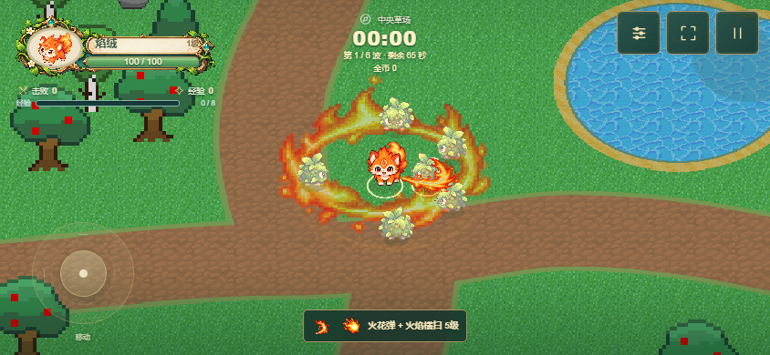
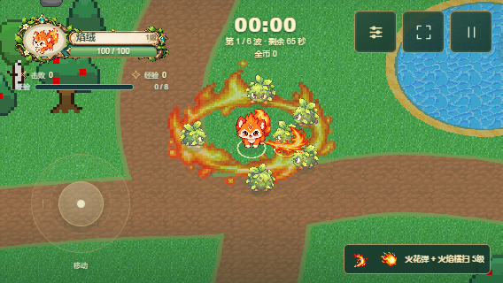

# 火焰横扫：现有素材特效升级

> 本页为旧横扫与火环叠加方案的历史记录。当前效果已重做为[单次成长火浪](FLAME-SWEEP-REDESIGN.md)，原小横扫和额外火环不再叠加显示。

2026-10-20。仅升级视觉呈现，沿用横扫成长与火环的伤害、范围、角度和周期。

## 素材复用

| 现有素材 | 帧 / 用法 | 表现 |
|---|---|---|
| `pixel/skills/flame-sweep/flame-sweep.png` | 原8帧、原锚点和短时序 | 主横扫火焰 |
| `pixel/skills/yanrong/fire-effects-sheet.normalized.png` | 12 → 13 → 14 | 从小圈到完整火圈的三段展开，替换整圈“小火种”外观 |
| 同一火焰图集 | 8 → 9 → 10 | 在真实命中位置播放短促火花，最多6处 |
| `particles/kenney-feedback.png` | 1（`star_04`） | 少量等宽等高的小火星；横扫最多5颗、火环最多6颗，不规则分布并轻微外散 |

原始PNG、规范化图集及CC0许可记录均未修改。继续使用最近邻采样、普通透明混合与关闭深度写入，保留现有像素画面风格。压低原程序化圆带亮度，用贴地火圈作为主体；火圈透明中心保留角色视野，控制区不增加元素。

根据截图反馈，已移除第4/5帧形成的直立条状火舌，以及第2帧的长条余烬；不再用32个重复粒子围一圈。火星宽高一致，世界尺寸0.09–0.14，透明度最高0.5，保持主火焰清晰。

## 生命周期与预算

- 新视觉只读取挥击/火环年龄、朝向和已有命中表，不产生攻击，不消耗弹池，不写入Combat状态。
- 挥击边缘沿实际扇形角度展开，火环固定在本次施放的位置；两个效果可独立结束。
- 暂停后火星和图集帧一起冻结。没有随机数、独立真实时间计时器或额外粒子模拟。
- 两个可复用图集批次：火焰8实例、火星12实例；最多2次额外绘制调用。每帧清空并复用实例数据，不逐粒子创建网格。
- 原程序化火环与扇形仍可回退。粒子图集缺失时省去点缀，保留主火圈；三张图集全部缺失时，程序化效果和真实伤害仍保留。
- 迟到的纹理加载回调检查释放状态；重开清空批次，释放时销毁图集、材质、几何体和实例资源。

## 验证

Chromium、WebKit相关60项测试全部通过，生产构建及 `git diff --check` 通过。范围包含：

- 三段火圈真实帧、稀疏火星数量、正方形尺寸、禁止条状粒子帧及绘制调用预算。
- GPU像素比较确认新增视觉实际出现在画面中。
- 连续100次渲染，Combat状态不变，GPU几何体/纹理数不增长。
- 暂停、重开、缺图回退和原8帧素材完整性。
- 四武器平衡、横扫范围成长、火环命中与原粒子反馈回归。
- 844×390、568×320手机横屏截图检查。

完整结果：`artifacts/flame-sparks-validation.json`、`artifacts/flame-sparks-validation.txt`。本轮没有重跑全部历史测试，也未进行真实手机帧率测量。

