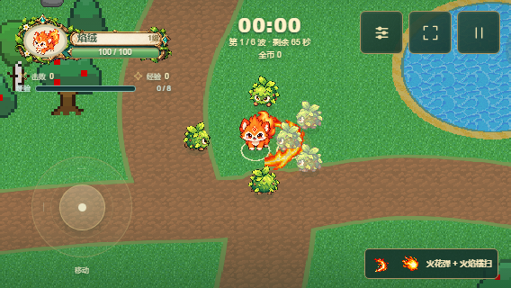
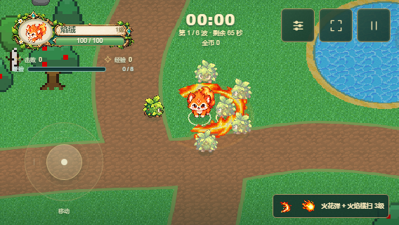
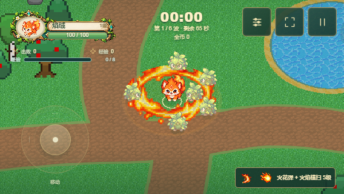

# 火焰横扫：单次成长火浪

2026-10-20。1级仍为扇形横扫，之后升级扩大覆盖；一次攻击只呈现同一片火浪。取消旧“小横扫 + 独立周期火环”机制，移除独立火环时钟、伤害结算及渲染状态。

| 武器等级 | 伤害 | 半径 | 角度 | 间隔 |
|---|---:|---:|---:|---:|
| 1 | 36 | 2.8 | 180° | 0.72秒 |
| 2 | 43.2 | 3.2 | 220° | 0.70秒 |
| 3 | 50.4 | 3.6 | 260° | 0.68秒 |
| 4 | 57.6 | 4.0 | 300° | 0.66秒 |
| 5 | 64.8 | 4.4 | 360° | 0.64秒 |

1–4级扇形从身体前沿0.55施放；5级同一次横扫覆盖整圈，以角色为圆心，不再有第二次周期攻击。每次对同一目标只结算一次伤害。对精英/首领仍为75%伤害，普通敌人全额；遮挡、出生保护、弹池独立、暂停、死亡及Boss流程沿用公共规则。

## 现有素材复用

使用焰绒图集`fire-effects-sheet.normalized.png`第12/13/14帧作为一套火浪，在真正的扇形几何体上绘制。网格角度、朝向、施放中心与Combat使用相同数据，低等级不会在身后画出完整火圈；升级直接扩大同一几何体。保留少量点状火星和最多6处命中火花。

旧八帧小横扫不再渲染；原图及来源校验仍保留。主效果最近邻采样、普通透明混合、关闭深度写入，控制白色核心亮度。默认三阶段230ms后快速淡出，三个预设仅改变亮度和时序，不改变攻击范围。

动画固定在本次施放地点；渲染不触发伤害，也不跟随角色移动拖拽出额外攻击范围。按用户反馈删除外围淡色范围描边，仅保留火焰贴图与底光；缺图时显示同一扇形的底光，不出现第二个攻击对象。共享GPU批次并复用几何体；改变武器等级时才更新角度网格。

## 平衡与复现

运行`npm run balance:weapons`生成120组真实Combat对比，输出`artifacts/weapon-balance-results.json`。近身/远处首领、排列敌人、密集群体、持续补充杂兵分别独立测量；同等级、同样两次额外强化预算。此探针固定敌人位置并禁用经验选择暂停，用于相对定位，不代表通关率或真实手机帧率。

自动约束继续检查：近身横扫首领DPS介于火花弹75%–115%；成型首领输出低于火花；8单位外横扫不能输出；飞叶对列输出至少比火花高40%；水泡远程减速覆盖超过95%；成型横扫近身清杂为火花的1.5–3.5倍。

## 验证与画面

验证包括：1/3/5级真实扇形网格与命中范围、单次攻击去重、无第二周期攻击、冷却进度、满弹池、出生保护、遮挡、暂停/死亡/重开、Boss死亡门、图集像素变化、稀疏火星、缺图回退及GPU资源复用。

Chromium与WebKit相关132项测试全部通过，另有边缘接敌验证2项通过；生产构建通过。结果见`artifacts/flame-redesign-validation.json`、`artifacts/flame-redesign-edge-validation.json`与对应日志；全量历史失败不在本轮中声称已修复。

1级：

3级：

5级：

