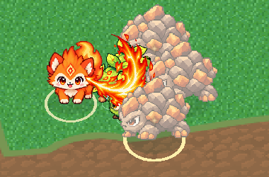

# V6.1-B 火焰横扫近战原型接入

日期：2026-10-20。基于当前 V6.1-A 工作区继续开发；保留现有商店、冲击波和界面代码改动。未提交、未引入新美术依赖。

## 实际帧数、尺寸与透明背景

用户提供的两张原图各为 **2172×724 RGBA**，第一张对应 1–4 帧，第二张对应 5–8 帧。文件自身已经有透明通道，预览中的黑底不等于不透明背景；本轮**没有执行去黑底**，避免损伤暗红火焰。

原图姿态间距不一致，直接按 543 像素四等分会切到其他帧。因此手动配置内容源矩形，按顺序切出 8 个姿态，再统一锚点、统一 0.5 缩放，重排成一张横向等宽图集。

| 项目 | 实际值 |
|---|---|
| 总帧数 | **8** |
| 运行时每帧 | **448×448** |
| 运行时图集 | **3584×448**，横向 8 列、1 行 |
| 根部锚点 | **(96,368)**，从每帧左上角计数 |
| 播放 | 初版为 20 FPS / 0.4 秒；视觉调优后默认选择 6 帧、非均匀播放 **230ms**，不循环，详见 [视觉调优](V6.1-B-VISUAL-TUNING.md) |
| 原图保留 | `public/assets/pixel/skills/flame-sweep/source-1.png`、`source-2.png`，字节未改 |
| 运行时贴图 | `public/assets/pixel/skills/flame-sweep/flame-sweep.png`（约 499 kB） |

每帧源矩形、原始根部坐标、原图 SHA-256 与输出规格都在同目录 `manifest.json`。8 张独立帧也已保留，便于以后调整或替换。

机械处理脚本为 `scripts/prepare-flame-sweep.py`，只依赖本机已有的 Pillow，不使用生成式 AI。可直接用已保存的原图重建：

```powershell
python scripts/prepare-flame-sweep.py public/assets/pixel/skills/flame-sweep/source-1.png public/assets/pixel/skills/flame-sweep/source-2.png
```

已验证重建图集的字节哈希与重建前相同。原图不是严格制作规范的均匀网格，少量边缘散点仍保留原型观感；本次不声称为最终品质美术。

## 接入方式与规则

运行开发服务器，打开 `/?world=fixed&meleeDev=flame-sweep`，点击「开始挑战」即可直接体验。该参数在正式挑战中额外装备横扫，重开后仍方便体验；不影响旧模式入口。无此参数时，可通过正式升级卡或波间商店获得「火焰横扫」。

- 武器 ID `flame-sweep`，卡牌 ID `flame-sweep-weapon`，`ATTACKS.kind = melee_arc`。与火花、水泡、叶刃共用现有三槽，四种武器最多同时装备三种；初始武器绑定保持不变。武器最高 5 级，每级基础伤害增加 20%。
- 基础伤害 **36**，从玩家朝向目标一侧的身体前沿 **0.55** 单位处释放，半径 **2.8**，夹角 **220°**，基础间隔 **0.9 秒**。装备时沿用槽位初次错峰，持续攻击采用独立冷却，不应用远程副武器的 1.6/1.9 间隔惩罚。
- 合法近敌出现后自动触发，出手瞬间锁定方向并结算一次有限扇形与敌人圆形的相交。包含扇形径向边界，检查实心障碍；预警出生中的敌人不可命中。固定 48 项命中记录与稳定 `attackInstanceId` 防止同次重复命中。
- 不创建隐形或可见子弹，不占 24 槽子弹池，也不等待远程连射结束或池中空位。分枝、分裂、连锁不复制横扫，不会引入无限派生。
- 复用 `damageEnemy` 的受击、击退、死亡、金币和 XP；Boss 仍不受击退，仍需走既有死亡过场才胜利。玩家死亡优先规则不变。现有伤害、攻速、范围与适用遗物倍率参与计算，没有新增遗物或事件总线。
- `FlameSweepView` 只复用一个贴图平面和一个纹理失败回退弧形。主特效为用户帧图；已有 Kenney 小型命中粒子作为辅助。未改角色模型、四足比例或骨骼，未加入手持武器动作。
- 渲染仅读取模拟时钟选帧；画面朝向相机并跟随投影的攻击方向，保留深度检测。当前默认为原版 70% 尺寸、纵向 68%、前爪高度根部、白芯衰减、230ms 非均匀播放，最后 60ms 快速淡出；轻微缩放与旋转均绕固定根部进行。伤害仍在出手瞬间结算。

代码主要位于 `src/flame-sweep.ts`、`src/flame-sweep-view.ts`、`src/combat.ts`、`src/combat-view.ts`。武器、卡牌和快捷体验接线位于 `run-build.ts`、`progression.ts`、`fusion.ts`、`upgrade-art.ts`、`ui.ts`、`game.ts`。

## 锚点抖动检查

**未观察到明显的火焰根部抖动。** 8 帧重排后共用同一个像素根部，不采用每帧包围盒中心，也不按各帧外接框单独缩放。浏览器依次播放 0–7 帧时，根部世界坐标完全一致；角色移动时，根部按相同位移跟随身体前沿，朝向保持本次出手快照。

透明像素和根部亮点也经过逐帧检测。动画中的大小、火舌轮廓和碎屑变化来自原图；小幅旋转与缩放是明确的程序表现，不是锚点漂移。第一版贴地显示被敌人遮住，最终已调整为身体前方的贴图显示平面，仍开启深度检测。

联系图：[八帧锚点检查](../artifacts/v6-1-b-frame-anchors.png)。

## 游戏内截图

以下来自真实 Game/Combat/CombatView 浏览器模块的固定验收场景：实际扇形攻击击败 4 只低血敌人，保留高血目标便于查看命中特效；不是完整一局的平衡或通关证明。



[完整游戏画面，第 4 帧](../artifacts/v6-1-b-sweep-frame-4.png) · [第 6 帧](../artifacts/v6-1-b-sweep-frame-6.png)

## 验证

- 修改前构建通过，选定的既有战斗基线 **62/62 通过**，见 `artifacts/v6-1-b-baseline-build.txt`、`v6-1-b-baseline-tests.txt`。
- 最终 `npm run build` 通过，保留原有 Three.js 分包大小提示，见 `artifacts/v6-1-b-build.txt`。
- 相关回归 **194/194 通过**，包括 Chromium/WebKit 下的近战、怪潮、升级、卡牌美术、三武器、已有融合、精英/Boss、六波购物与胜败流程，见 `artifacts/v6-1-b-final-tests.txt`。本轮没有重复执行上轮含既有界面失败的全量集合。
- 最终近战专项及后补持续攻击/移动锚点检查 **22/22 通过**，见 `artifacts/v6-1-b-final-melee-tests.txt`。覆盖源图哈希、8 帧规格、扇形前后/边界、障碍与预警、满子弹池仍能清群、真实奖励去重、连续自动冷却、独立命中编号、暂停/死亡冻结、重开/波末清理、三槽满时过滤第四武器、五级上限、Boss 胜败、缺图回退、实际八帧 GPU 画面差异、固定根部和角色移动跟随。
- 调整两项严格预期：卡牌美术覆盖从 **22** 增至 **23** 个真实 ID；装备三种原武器后，最大等级预算应减去未选第四武器的 **5** 个强化机会和已失效专精徽记的 **1** 个机会，并新增满槽过滤断言。未删除或放宽原断言。

本轮完成近战原型接入，不包含其他近战、新遗物、风险选择、新怪物或全局平衡重做。
