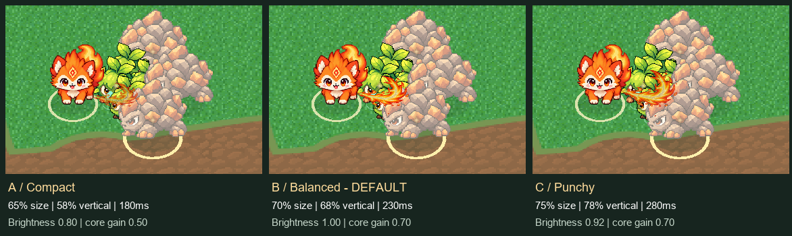

# V6.1-B 火焰横扫视觉调优

2026-10-20。`IMPLEMENTED`：沿用用户八帧素材，仅修改渲染接入，默认推荐 **B / balanced**。原图、图集、近战逻辑均未改。

## 三组实机画面对比

同一浏览器固定场景、同一原图第 5 帧（代码 frame=4）的爆发段截图。真实 Game 调用一次扇形攻击击败四只低血敌人，保留高血敌人检查遮挡；三组使用各自爆发段中点，非人工绘制效果。角色周围的大型岩甲用于暴露拥挤时的可读性问题，不代表自然刷怪阵型。

| 参数 | A 紧凑 | B 实战均衡（默认） | C 强调反馈 |
|---|---:|---:|---:|
| 相对旧版尺寸 | 65% | **70%** | 75% |
| 根部朝向前移 / 世界高度 | 0.72 / 0.45 | **0.78 / 0.60** | 0.82 / 0.72 |
| 屏幕纵向比例 | 58% | **68%** | 78% |
| 整体亮度系数 | 0.80 | **1.00** | 0.92 |
| 白芯增益 | 0.50 | **0.70** | 0.70 |
| 基础不透明度 | 0.70 | **0.96** | 0.86 |
| 根部 / 远端透明遮罩系数 | 0.22 / 0.22 | **0.65 / 0.45** | 0.38 / 0.38 |
| 播放帧数 | 5 | **6** | 8 |
| 总时长 / 淡出起点 | 180 / 125ms | **230 / 170ms** | 280 / 225ms |

这些是材质与几何系数，不等同于最终显示器感知亮度百分比。白芯按 RGB 中性程度识别，再施加暖色衰减，橙红边缘主要受整体亮度影响；根部和远端按帧内 UV 到固定根部的距离渐变透明，最终与贴图 alpha、动画淡出相乘。

B 保留足够辨识度，同时不再以高大白弧压过小火狐；A 在密集怪群里偏弱，C 遮挡更多，适合比对反馈上限。此推荐依据浏览器画面检查，**不是移动设备硬件性能测试**。

后续按用户反馈将 B 的整体亮度从 0.86 提至 1.00、白芯增益从 0.60 提至 0.70。保留暖色核心、透明遮罩、尺寸、锚点与播放节奏；A/C 参数不变。

再次按“画面发虚”的反馈收紧透明遮罩：B 基础不透明度由 0.80 提至 0.96，根部最低系数 0.30→0.65、远端 0.30→0.45。共享材质的根部渐变仅覆盖 UV 径向距离 0.008–0.065（原 0.015–0.12），远端渐变延后至 0.62–0.86（原 0.38–0.76），中段不再被额外淡化。白芯暖色乘数由 `(1,.60,.25)` 改为 `(1,.82,.35)`，恢复亮黄与橙红边缘的对比。保留原图 alpha、最近邻过滤及末尾快速淡出；尺寸、锚点、压缩比例、播放节奏与命中均不变。

清晰度前后对比：[调整前](../artifacts/v6-1-b-clarity-before.png) / [调整后](../artifacts/v6-1-b-visual-balanced-detail.png)。

完整截图：[A 桌面](../artifacts/v6-1-b-visual-compact-1280.png) / [B 桌面](../artifacts/v6-1-b-visual-balanced-1280.png) / [C 桌面](../artifacts/v6-1-b-visual-punchy-1280.png)。

844×390 窄视口截图：[A](../artifacts/v6-1-b-visual-compact-844.png) / [B](../artifacts/v6-1-b-visual-balanced-844.png) / [C](../artifacts/v6-1-b-visual-punchy-844.png)。[修改前同场景](../artifacts/v6-1-b-visual-original.png)。

## 接入、节奏与锚点

- `src/flame-sweep-visual.ts` 集中配置 A/B/C，并由模拟年龄采样；`src/flame-sweep-view.ts` 只消费样本。体验网址 `/?world=fixed&meleeDev=flame-sweep&sweepVisual=balanced`，最后一项可换 `compact` / `punchy`；省略或非法值均回落到 B。
- B 的原图帧序号（从 1 开始）为 **1 / 3 / 4 / 5 / 7 / 8**，时长 **15 / 25 / 65 / 65 / 35 / 25ms**。起手短，两个中段峰值各停留 65ms，170ms 后按 1.5 次幂快速淡出，230ms 后隐藏。没有补循环。
- 图集仍为 **8×448×448**，总 **3584×448**，每帧同一像素锚点 **(96,368)**。降低根部至前爪/前胸高度，并沿本次出手的锁定方向前移；缩放与旋转绕根部，屏幕纵向压缩独立施加，方向投影补偿压缩。截图逐帧与移动跟随检查未观察到明显根部抖动。
- 敌人立绘写入深度，单纯降低根部会将整条横扫埋在敌人后面。对子组沿相机局部 Z 偏置 2.2 单位，仅改变深度，不改变屏幕锚点；仍开启深度检测、不写深度，避免全局关闭深度检测。它仍是面向相机的贴图加轻斜视压缩，并非新建完整地面三维横扫；极拥挤场景可有局部遮挡。
- 材质增加白芯衰减和 UV 透明遮罩，沿用同一张贴图、一个可复用平面，未新增美术依赖或子弹。已有命中辅助粒子继续沿用。
- 保留基础伤害 **36**、扇形 **220°**、半径 **2.8**、冷却 **0.9s**、真实命中起点前移 **0.55**、出手瞬时结算与模拟生命周期 **0.4s**。视觉尺寸、根部和结束时间均不参与命中判断。未改 `src/combat.ts` 和 `src/flame-sweep.ts`，前后 SHA-256 比对一致。

## 验证记录

- 清晰度调整后：`npm run build` 通过，Chromium/WebKit 下近战逻辑、视觉时间线与浏览器渲染 **30/30 通过**，日志为 `artifacts/v6-1-b-clarity-build.txt`、`artifacts/v6-1-b-clarity-tests.txt`；战斗源码哈希仍与视觉调优前一致。截图确认中段更实、亮黄核心更清楚，保留原有尺寸与低位锚点。

- 开发前 `npm run build` 通过，近战模型基线 **16/16** 通过：`artifacts/v6-1-b-visual-baseline-*.txt`。
- 调优后构建通过，仍有原有 Three.js 包大于 500kB 的提示：`artifacts/v6-1-b-visual-build.txt`。
- 自动检查覆盖各参数范围与时间线、所有选用帧的 GPU 输出差异、固定根部和移动跟随、真实像素高亮衰减、只渲染不结算伤害、结束隐藏而不提前结束 Combat、暂停/重开/旧模式、缺图回退、八帧透明像素与原始锚点，以及既有精英/Boss/胜败和奖励流程。
- 首轮回归 68/70，两项失败来自新增像素测试把“手动设置动画年龄之前”的 Combat 快照拿来比较；已改为先固定模拟年龄再比较，保留全部断言，单项重验 **2/2** 通过。初次日志保留在 `artifacts/v6-1-b-visual-regression-first.txt`。
- 最终 Chromium / WebKit 相关回归 **70/70 通过**：`artifacts/v6-1-b-visual-final-tests.txt`。执行命令：`node node_modules/@playwright/test/cli.js test tests/flame-sweep.spec.ts tests/flame-sweep-visual.spec.ts tests/flame-sweep-ui.spec.ts tests/run-flow.spec.ts tests/enemy-challenge.spec.ts tests/run-flow-ui.spec.ts tests/enemy-challenge-ui.spec.ts --reporter=line`。未执行包含已知界面基线失败的整个历史测试集合。

截图由 `tests/flame-sweep-ui.spec.ts` 输出；`python scripts/compare-flame-sweep-visuals.py` 只拼接实际截图与参数文字，不改素材。未加入其他 V6 战斗功能，也未重做平衡。
