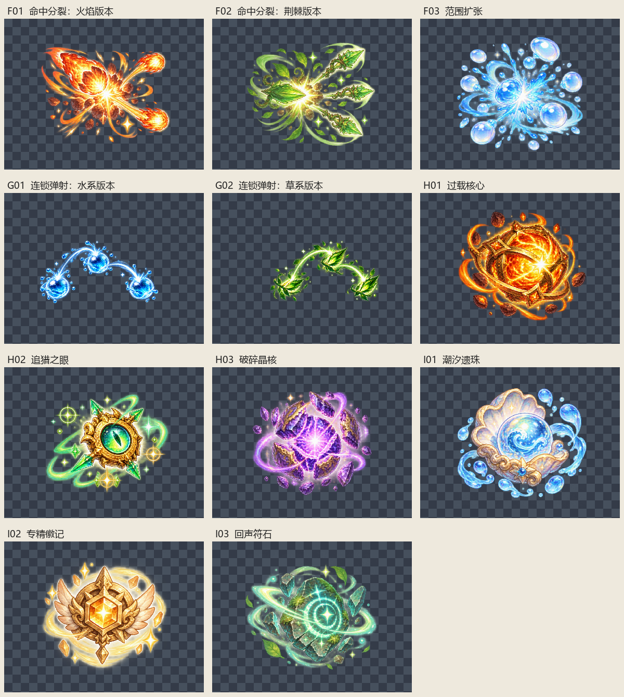

# 界面批量素材裁切清单

本次检查 4 张原图，按提供的从左到右顺序切出 11 个独立素材：技能 5 张、稀有道具 6 张。全部为真实 RGBA，原图尺寸均为 2172×724。无需去白底，白色高光和内部颜色保持原样。

## 处理方式与验收范围

- 先分析透明度列投影，再人工校正不等宽的分界。分界两侧最多只有透明度 1–2 的残点，没有切过角色或可见特效主体。
- 按全部非零透明度像素取边界，保留原始色值、半透明光晕、耳朵、叶片和粒子；不做阈值清除。每张置于原生分辨率的正方形透明画布，四周至少 24 像素安全边距。
- 原图带少量散落的极低透明度残点，因此采用保守边界，部分成品留白较多。原图最外沿也有极低透明度残点，均保留；未发现可见主体被原图边缘截断。
- 提示词中的 512×512 并非原图真实规格。本次不缩放，避免丢失像素和微弱光晕；实际输出尺寸见表。
- 验收通过表示顺序、独立裁切、主体完整度、透明通道和导出保真通过；不代表重新生成内容或审核角色设计一致性。
- 成品重新打开后与预期逐像素一致；每批全部非零透明度像素数量和透明度总和均保留，原图校验值未改变。
- 技能与元素版本存入 skills；稀有道具存入 relics。使用小写短横线命名，元素版本使用独立后缀。未修改游戏代码或执行游戏测试。
- 旧批次原图已不在当前 raw 中，历史 12 张成品及原清单保留。本清单仅涵盖当前批次；不是运行时技能动画，不直接接入战斗。
- 已有内容不同的文件绝不覆盖，自动增加版本后缀。清单 JSON 包含原图 SHA256、分区坐标、粘贴偏移及完整规格。

机器可读清单：[asset-manifest-v2.json](asset-manifest-v2.json)。历史清单：[ASSET-MANIFEST.md](ASSET-MANIFEST.md)。

## 原图规格

| 来源 | 尺寸 | 模式 | 透明度范围 | 透明度级数 |
|---|---|---|---|---|
| raw/三系元素魔法爆发特效.png | 2172×724 | RGBA | 0–253 | 254 |
| raw/水叶双链魔法特效.png | 2172×724 | RGBA | 0–254 | 255 |
| raw/三枚魔法神器图标.png | 2172×724 | RGBA | 0–255 | 256 |
| raw/三件奇幻魔法神器图标.png | 2172×724 | RGBA | 0–255 | 256 |

## 裁切清单

裁切坐标为原图像素 `[左, 上, 右, 下)`，右、下边界不包含在内。

| 编号 | 素材 | 来源文件 | 裁切坐标 | 最终文件 | 尺寸 | 验收 |
|---|---|---|---|---|---|---|
| F01 | 命中分裂：火焰版本 | raw/三系元素魔法爆发特效.png | [0, 9, 732, 724] | [skills/split-on-hit-fire.png](skills/split-on-hit-fire.png) | 780×780 | 通过 |
| F02 | 命中分裂：荆棘版本 | raw/三系元素魔法爆发特效.png | [732, 9, 1438, 724] | [skills/split-on-hit-thorn.png](skills/split-on-hit-thorn.png) | 763×763 | 通过 |
| F03 | 范围扩张 | raw/三系元素魔法爆发特效.png | [1438, 0, 2172, 724] | [skills/area-expansion.png](skills/area-expansion.png) | 782×782 | 通过 |
| G01 | 连锁弹射：水系版本 | raw/水叶双链魔法特效.png | [0, 9, 1050, 708] | [skills/chain-bounce-water.png](skills/chain-bounce-water.png) | 1098×1098 | 通过 |
| G02 | 连锁弹射：草系版本 | raw/水叶双链魔法特效.png | [1055, 9, 2172, 724] | [skills/chain-bounce-grass.png](skills/chain-bounce-grass.png) | 1165×1165 | 通过 |
| H01 | 过载核心 | raw/三枚魔法神器图标.png | [0, 15, 714, 724] | [relics/overload-core.png](relics/overload-core.png) | 762×762 | 通过 |
| H02 | 追猎之眼 | raw/三枚魔法神器图标.png | [714, 0, 1486, 724] | [relics/hunter-eye.png](relics/hunter-eye.png) | 820×820 | 通过 |
| H03 | 破碎晶核 | raw/三枚魔法神器图标.png | [1486, 8, 2172, 724] | [relics/shattered-core.png](relics/shattered-core.png) | 764×764 | 通过 |
| I01 | 潮汐遗珠 | raw/三件奇幻魔法神器图标.png | [0, 0, 714, 724] | [relics/tidal-pearl.png](relics/tidal-pearl.png) | 772×772 | 通过 |
| I02 | 专精徽记 | raw/三件奇幻魔法神器图标.png | [714, 0, 1461, 724] | [relics/specialist-badge.png](relics/specialist-badge.png) | 795×795 | 通过 |
| I03 | 回声符石 | raw/三件奇幻魔法神器图标.png | [1461, 0, 2172, 724] | [relics/echo-rune.png](relics/echo-rune.png) | 772×772 | 通过 |

预览：

