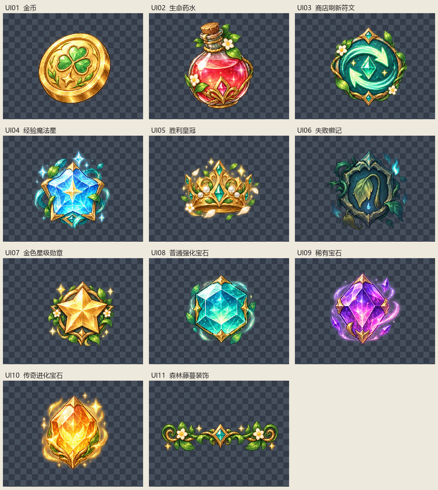

# 界面批量素材裁切清单

本次检查 1 张原图，按行从左到右切出 11 个独立素材。全部为真实 RGBA，真实尺寸与分类见下表。无需去白底，白色高光和内部颜色保持原样。

## 处理方式与验收范围

- 先分析透明度列投影，再人工校正不等宽的分界。分界两侧最多只有透明度 1–2 的残点，没有切过角色或可见特效主体。
- 按全部非零透明度像素取边界，保留原始色值、半透明光晕、耳朵、叶片和粒子；不做阈值清除。每张置于原生分辨率的透明画布，四周至少 24 像素安全边距。图标使用正方形画布，森林藤蔓保留横向画布。
- 原图带少量散落的极低透明度残点，因此采用保守边界，部分成品留白较多。原图最外沿也有极低透明度残点，均保留；未发现可见主体被原图边缘截断。
- 提示词中的 512×512 并非原图真实规格。本次不缩放，避免丢失像素和微弱光晕；实际输出尺寸见表。
- 验收通过表示顺序、独立裁切、主体完整度、透明通道和导出保真通过；不代表重新生成内容或审核角色设计一致性。
- 成品重新打开后与预期逐像素一致；每批全部非零透明度像素数量和透明度总和均保留，原图校验值未改变。
- 分类：common 通用金币及藤蔓；shop 药水及刷新；hud 经验星；result 皇冠、失败徽记及星级；upgrade 三种宝石；历史技能与道具分属 skills 和 relics。未修改游戏代码或执行游戏测试。
- 旧批次原图已不在当前 raw 中，历史 23 张成品及原清单保留。本清单仅涵盖当前批次。
- 已有内容不同的文件绝不覆盖，自动增加版本后缀。清单 JSON 包含原图 SHA256、分区坐标、粘贴偏移及完整规格。

机器可读清单：[asset-manifest-v3.json](asset-manifest-v3.json)。历史清单：[ASSET-MANIFEST.md](ASSET-MANIFEST.md)。

## 原图规格

| 来源 | 尺寸 | 模式 | 透明度范围 | 透明度级数 |
|---|---|---|---|---|
| raw/奇幻RPG宝石花叶图标集.png | 1448×1086 | RGBA | 0–255 | 256 |

## 裁切清单

裁切坐标为原图像素 `[左, 上, 右, 下)`，右、下边界不包含在内。

| 编号 | 素材 | 来源文件 | 裁切坐标 | 最终文件 | 尺寸 | 验收 |
|---|---|---|---|---|---|---|
| UI01 | 金币 | raw/奇幻RPG宝石花叶图标集.png | [0, 0, 392, 388] | [common/coin.png](common/coin.png) | 440×440 | 通过 |
| UI02 | 生命药水 | raw/奇幻RPG宝石花叶图标集.png | [411, 26, 695, 379] | [shop/health-potion.png](shop/health-potion.png) | 401×401 | 通过 |
| UI03 | 商店刷新符文 | raw/奇幻RPG宝石花叶图标集.png | [697, 23, 1091, 388] | [shop/refresh-rune.png](shop/refresh-rune.png) | 442×442 | 通过 |
| UI04 | 经验魔法星 | raw/奇幻RPG宝石花叶图标集.png | [1101, 23, 1447, 388] | [hud/experience-star.png](hud/experience-star.png) | 413×413 | 通过 |
| UI05 | 胜利皇冠 | raw/奇幻RPG宝石花叶图标集.png | [0, 388, 551, 776] | [result/victory-crown.png](result/victory-crown.png) | 599×599 | 通过 |
| UI06 | 失败徽记 | raw/奇幻RPG宝石花叶图标集.png | [560, 388, 939, 776] | [result/defeat-badge.png](result/defeat-badge.png) | 436×436 | 通过 |
| UI07 | 金色星级勋章 | raw/奇幻RPG宝石花叶图标集.png | [950, 388, 1422, 776] | [result/star-medal.png](result/star-medal.png) | 520×520 | 通过 |
| UI08 | 普通强化宝石 | raw/奇幻RPG宝石花叶图标集.png | [0, 776, 314, 1086] | [upgrade/gem-common.png](upgrade/gem-common.png) | 362×362 | 通过 |
| UI09 | 稀有宝石 | raw/奇幻RPG宝石花叶图标集.png | [315, 776, 615, 1086] | [upgrade/gem-rare.png](upgrade/gem-rare.png) | 358×358 | 通过 |
| UI10 | 传奇进化宝石 | raw/奇幻RPG宝石花叶图标集.png | [618, 776, 891, 1086] | [upgrade/gem-legendary.png](upgrade/gem-legendary.png) | 358×358 | 通过 |
| UI11 | 森林藤蔓装饰 | raw/奇幻RPG宝石花叶图标集.png | [894, 777, 1434, 1086] | [common/forest-vine.png](common/forest-vine.png) | 588×357 | 通过 |

预览：

