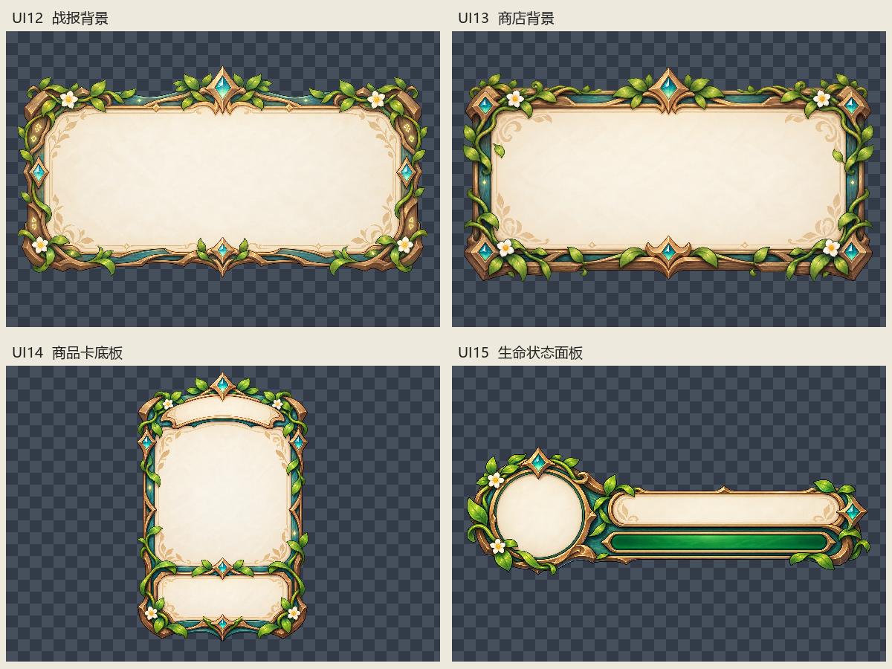

# UI12–UI15 面板素材分类清单

4 张均为独立成品、真实 RGBA。已保留完整原始尺寸及透明通道，按用途复制分类，无需批量切分。没有去白、裁切、缩放或重编码，羊皮纸内部、白色高光及光晕均保留。

原图及历史文件保留，内容不同的同名目标自动添加版本后缀。分类后文件与原图字节一致。未修改游戏代码，未运行游戏测试。

分类验收通过只表示内容、用途、尺寸、通道与复制保真已确认，不表示已接入界面。

| 编号 | 来源 | 分类文件 | 真实尺寸 | 模式 | 透明度范围 | 裁切范围 | 状态 |
|---|---|---|---|---|---|---|---|
| UI12 | raw/冒险战报羊皮纸背景.png | [result/battle-report-panel.png](result/battle-report-panel.png) | 1672×941 | RGBA | [0, 255] | [0, 0, 1672, 941]（整图） | 分类通过 |
| UI13 | raw/森林魔法商店背景.png | [shop/shop-panel.png](shop/shop-panel.png) | 1672×941 | RGBA | [0, 255] | [0, 0, 1672, 941]（整图） | 分类通过 |
| UI14 | raw/商店商品槽位.png | [shop/item-slot.png](shop/item-slot.png) | 1024×1536 | RGBA | [0, 254] | [0, 0, 1024, 1536]（整图） | 分类通过 |
| UI15 | raw/幻兽生命状态面板.png | [hud/creature-health-panel.png](hud/creature-health-panel.png) | 2172×724 | RGBA | [0, 255] | [0, 0, 2172, 724]（整图） | 分类通过 |

## 接入备注

- UI12：中心羊皮纸保留，适合覆盖动态战斗数据与技能列表。
- UI13：中心留白，商品槽位应由代码布局。
- UI14：外部带背景氛围；保留原始透明度，不做自动抠图。下方留白可覆盖价格与购买按钮。
- UI15：左侧头像区与右侧文字区保留羊皮纸底。绿色血条已画入原图，动态血量接入需另行处理，不能直接当空血条框使用。

机器可读清单：[asset-manifest-v4.json](asset-manifest-v4.json)。

