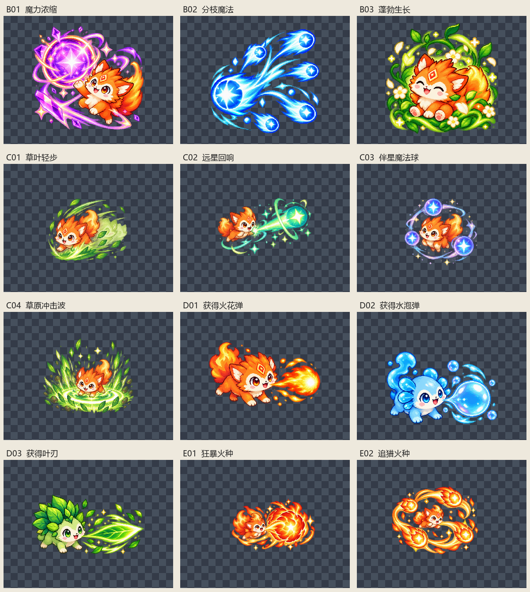

# 界面批量素材裁切清单

共检查 4 张原图，按提供的从左到右顺序切出 12 个独立素材。全部为真实 RGBA，原图尺寸均为 2172×724，透明度覆盖 0–255（256 级）。无需去白底，白色高光和内部颜色保持原样。

## 处理方式与验收范围

- 先分析透明度列投影，再人工校正不等宽的分界。分界两侧最多只有透明度 1–2 的残点，没有切过角色或可见特效主体。
- 按全部非零透明度像素取边界，保留原始色值、半透明光晕、耳朵、叶片和粒子；不做阈值清除。每张置于原生分辨率的正方形透明画布，四周至少 24 像素安全边距。
- 原图带少量散落的极低透明度残点，因此采用保守边界，部分成品留白较多。原图最外沿也有极低透明度残点，均保留；未发现可见主体被原图边缘截断。
- 提示词中的 512×512 并非原图真实规格。本次不缩放，避免丢失像素和微弱光晕；实际输出尺寸见表。
- 验收通过表示顺序、独立裁切、主体完整度、透明通道和导出保真通过；不代表重新生成内容或审核角色设计一致性。
- 成品重新打开后与预期逐像素一致；每批全部非零透明度像素数量和透明度总和均保留，原图校验值未改变。
- 使用与现有技能/进化标识一致的小写短横线命名，均存入 skills；无对应素材的分类不创建空文件。未修改游戏代码或执行游戏测试。
- 已有内容不同的文件绝不覆盖，自动增加版本后缀。清单 JSON 包含原图 SHA256、分区坐标、粘贴偏移及完整规格。

裁切坐标为原图像素 `[左, 上, 右, 下)`，右、下边界不包含在内。

| 编号 | 素材 | 来源文件 | 裁切坐标 | 最终文件 | 尺寸 | 验收 |
|---|---|---|---|---|---|---|
| B01 | 魔力浓缩 | raw/三联魔法精灵像素特效.png | [0, 14, 762, 724] | [skills/damage.png](skills/damage.png) | 810×810 | 通过 |
| B02 | 分枝魔法 | raw/三联魔法精灵像素特效.png | [762, 9, 1435, 702] | [skills/multishot.png](skills/multishot.png) | 741×741 | 通过 |
| B03 | 蓬勃生长 | raw/三联魔法精灵像素特效.png | [1447, 28, 2162, 724] | [skills/vitality.png](skills/vitality.png) | 763×763 | 通过 |
| C01 | 草叶轻步 | raw/四连魔法狐灵技能图标.png | [0, 0, 523, 724] | [skills/movement.png](skills/movement.png) | 772×772 | 通过 |
| C02 | 远星回响 | raw/四连魔法狐灵技能图标.png | [523, 6, 1126, 724] | [skills/range.png](skills/range.png) | 766×766 | 通过 |
| C03 | 伴星魔法球 | raw/四连魔法狐灵技能图标.png | [1126, 9, 1583, 684] | [skills/orbit.png](skills/orbit.png) | 723×723 | 通过 |
| C04 | 草原冲击波 | raw/四连魔法狐灵技能图标.png | [1584, 10, 2171, 724] | [skills/shockwave.png](skills/shockwave.png) | 762×762 | 通过 |
| D01 | 获得火花弹 | raw/三元素萌宠攻击精灵图.png | [0, 19, 740, 724] | [skills/spark-weapon.png](skills/spark-weapon.png) | 788×788 | 通过 |
| D02 | 获得水泡弹 | raw/三元素萌宠攻击精灵图.png | [748, 7, 1404, 577] | [skills/bubble-weapon.png](skills/bubble-weapon.png) | 704×704 | 通过 |
| D03 | 获得飞叶弹 | raw/三元素萌宠攻击精灵图.png | [1409, 9, 2172, 724] | [skills/leaf-weapon.png](skills/leaf-weapon.png) | 811×811 | 通过 |
| E01 | 狂暴火种 | raw/双狐烈焰技能精灵图.png | [0, 9, 1086, 704] | [skills/berserk-route.png](skills/berserk-route.png) | 1134×1134 | 通过 |
| E02 | 追猎火种 | raw/双狐烈焰技能精灵图.png | [1087, 45, 2152, 724] | [skills/pursuit-route.png](skills/pursuit-route.png) | 1113×1113 | 通过 |

预览：

