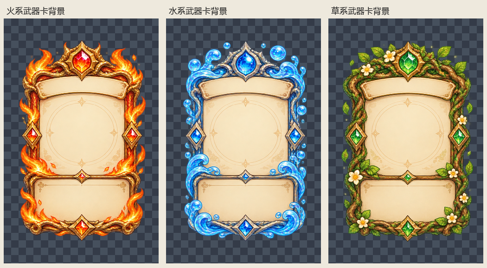

# 元素武器卡背景切分清单

原图：elements-sheet.png，1774×887，RGBA。顺序：火、水、草。分界为原图 x=573、1165，分界两侧均为完全透明像素。

保留全部非零透明像素及原始色值，不缩放、不去背景，羊皮纸内容区保持完整。三个成品采用统一画布，四周至少24像素透明安全边距。原合并图及已有文件保留。逐像素导出核对通过，原图校验值未变。

坐标为原图像素 [左,上,右,下)，右下不包含。

| 素材 | 裁切坐标 | 成品 | 统一尺寸 | 验收 |
|---|---|---|---|---|
| 火系武器卡背景 | [0, 6, 572, 887] | [weapon-fire.png](weapon-fire.png) | 652×935 | 通过 |
| 水系武器卡背景 | [596, 3, 1164, 887] | [weapon-water.png](weapon-water.png) | 652×935 | 通过 |
| 草系武器卡背景 | [1170, 0, 1774, 887] | [weapon-grass.png](weapon-grass.png) | 652×935 | 通过 |

完整规格：[ELEMENTS-MANIFEST.json](ELEMENTS-MANIFEST.json)。

